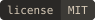
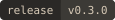
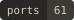
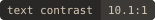
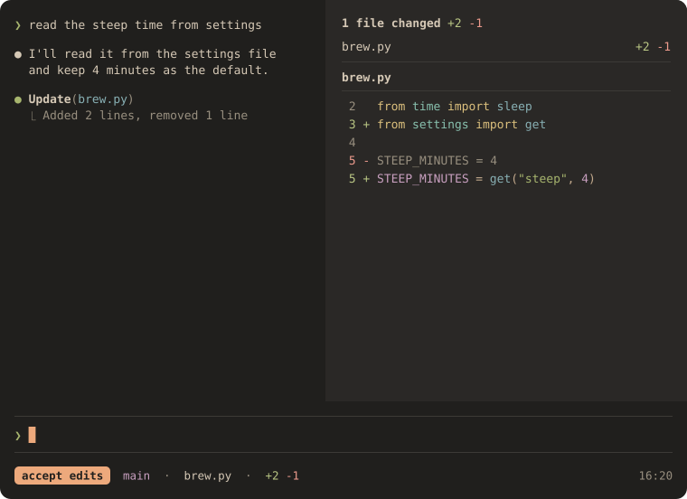
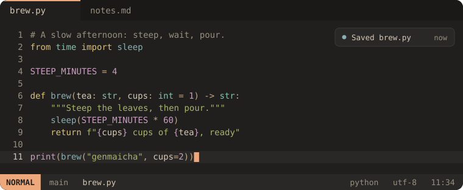
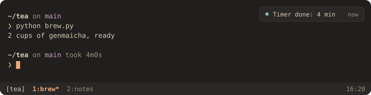
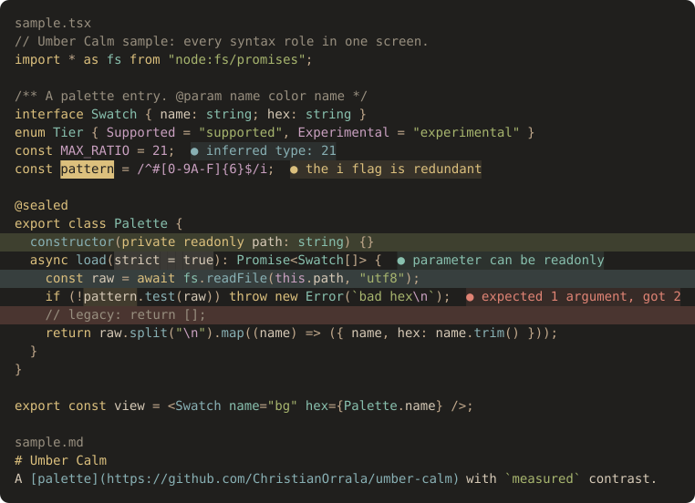
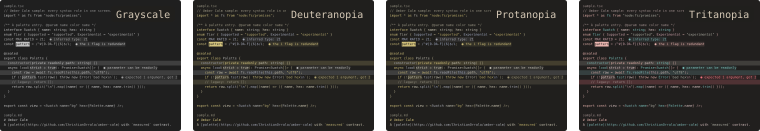

<div align="center">

# Umber Calm

A warm, low-glare dark palette with measured contrast.

[Palette](#palette) · [Install](#install) · [Ports](#ports) · [Design](#design)

   

<br><br>



</div>

## Why it exists

I made Umber Calm for my own eyes. I spend long days in terminals and editors, mostly on OLED screens. Most dark themes I tried felt loud to me there: bright white text on pure black, saturated blues, accents all competing for attention. So I started tuning my own.

On an OLED, pure black means the pixels switch off completely, so every bright letter sits on nothing at all. Umber Calm keeps the background a warm near-black and the text a warm off-white. The screen stays gently lit, and the contrast stays high without turning harsh.

I also wanted it to be less distracting. Color only shows up where it tells me something: a keyword, an error, or the one warm amber that marks where I am. Nothing is there just to decorate.

It began as a few colors in my dotfiles. I used them every day for months, on different machines and at different hours. Whenever something got in the way, I changed it. When I wasn't sure a color worked, I measured it instead of guessing.

What's left is the palette I want to look at all day. I'm sharing it in case it feels that way to you too. If it doesn't, the right palette is simply the one that's comfortable for you.

<hr>

<div align="center">
<details>
<summary><b>See everything at once</b><br><sub>an editor, a terminal, every syntax role and state, and color-vision renders</sub></summary>

<br>



<br><br>



<br><br>



<br><br>



<sub>The same code in grayscale and under three types of color-vision deficiency (Machado, Oliveira &amp; Fernandes, 2009). Details in [docs/color-vision.md](docs/color-vision.md).</sub>

</details>
</div>

<hr>

## Why it looks like this

- Warm near-black background (never pure black) and warm off-white text (never pure white).
- Main text at 10:1; accents between 6:1 and 9.3:1; every measured pair is enforced in CI.
- Categories are separated by hue while lightness stays in a narrow band.
- Red only means errors and deletions; amber only marks where you are.

## Recommendations

### Font

Umber Calm works with any monospaced font, but the font changes how the palette looks. A heavy font makes the whole screen look denser. A more open one leaves more of the warm background around each letter.

What I look for:

- **Regular weight.** Medium and bold put more ink in every letter. I looked for evidence that heavier strokes read better on a dark background and didn't find it: a 2023 study detected no dark-mode reading advantage from heavier strokes in the text it tested ([CHI 2023, PDF](https://thereadabilityconsortium.org/wp-content/uploads/2023/07/How-bold-can-we-be-The-impact-of-adjusting-font-grade-on-readability-in-light-and-dark-polarities-1.pdf)).
- **Size by lowercase height, not by point size.** Two fonts at 12 can have very different lowercase heights. Compare them with their lowercase at the same height, then pick the size you like.
- **Look-alike characters.** Check `0` and `O`, `1`, `l` and `I`, `rn` and `m`, and the punctuation you actually mix up, at the size you use.
- **Icons**, if your prompt or status line uses them: a [Nerd Fonts](https://www.nerdfonts.com/font-downloads) build, or the font plus Symbols Nerd Font Mono as a fallback.
- **Your own app.** The same font can look lighter or heavier depending on the app, the screen and its scaling.

Three I'd start with, in the order I'd try them. All are free under the SIL Open Font License:

| Font | Icons | Size next to JetBrains Mono at 12 | Why I like it |
|---|---|---|---|
| [Atkinson Hyperlegible Mono](https://fonts.google.com/specimen/Atkinson+Hyperlegible+Mono) | Install the Google Fonts build plus Symbols Nerd Font Mono. The Nerd Font build (AtkynsonMono Nerd Font Mono, Nerd Fonts 3.5.1) has no backtick. | about 13.3 | Look-alike characters get clearly different shapes, and the letters are wide and open. |
| [Source Code Pro](https://github.com/adobe-fonts/source-code-pro) | SauceCodePro Nerd Font Mono | about 13.5 | Open letters and the most line spacing of the three for its lowercase height. Its lowercase is small, so it needs a larger size. |
| [IBM Plex Mono](https://github.com/IBM/plex) | BlexMono Nerd Font Mono | about 13 | The thinnest strokes of the three and the most columns. Its `1`, `l` and `I` are closer to each other, so check them first. |

Wider letters fit fewer columns: in the same pane, at the same lowercase height, JetBrains Mono fits about 72 columns, Plex 69, Source Code Pro 64 and Atkinson 62. The sizes are approximate and depend on the app.

For sidebars, menus and settings, consider a proportional font: the interface doesn't have to share the terminal's font. Change one thing at a time, so you can tell which change you like.

These are starting points, not rules. Choose the font, weight and size you prefer in your own app.

## Palette

<!-- palette:begin -->
|  | Name | Hex | Contrast on `bg` | Used for |
|---|---|---|---|---|
|  | `bg` | `#201F1D` | — | Background |
|  | `bg_dim` | `#1A1917` | 1.1:1 | Chrome |
|  | `surface` | `#2A2826` | 1.1:1 | Panels |
|  | `overlay` | `#3C3A36` | 1.5:1 | Selection, strong borders |
|  | `inactive` | `#5A554E` | 2.2:1 | Borders |
|  | `dim_text` | `#77726A` | 3.5:1 | Dim text |
|  | `muted` | `#988F7F` | 5.2:1 | Comments, secondary text, line numbers |
|  | `subtle` | `#C2A98C` | 7.3:1 | Operators |
|  | `text` | `#D6C9B6` | 10.1:1 | Variables, body text, current line number |
|  | `text_bright` | `#EDE3D2` | 13.0:1 | ANSI bright white |
|  | `red` | `#E08374` | 6.0:1 | Errors, deleted lines |
|  | `orange` | `#EDA97C` | 8.3:1 | Focus, cursor |
|  | `yellow` | `#DCC07D` | 9.3:1 | Keywords, preprocessor, headings, warnings, search |
|  | `green` | `#A7B56E` | 7.4:1 | Strings, inline code, success, added lines |
|  | `cyan` | `#88C0AE` | 8.0:1 | Types, namespaces, attributes, hints |
|  | `blue` | `#88B0B4` | 7.0:1 | Functions, tags, links, info, changed lines |
|  | `purple` | `#C9A0C0` | 7.3:1 | Escapes, constants, built-ins |
<!-- palette:end -->

## Install

**Neovim** (0.10 or newer, lazy.nvim):

```lua
{ "ChristianOrrala/umber-calm", lazy = false, priority = 1000, config = function() vim.cmd.colorscheme("umber-calm") end }
```

**VS Code:** install [Umber Calm from the Marketplace](https://marketplace.visualstudio.com/items?itemName=ChristianOrrala.umber-calm), or download `umber-calm-<version>.vsix` from the [latest release](https://github.com/ChristianOrrala/umber-calm/releases/latest) and run `code --install-extension umber-calm-<version>.vsix`; then pick *Umber Calm* with Cmd/Ctrl+K Cmd/Ctrl+T.

**A terminal (WezTerm):** copy [`ports/wezterm/umber-calm.toml`](ports/wezterm/umber-calm.toml) to `~/.config/wezterm/colors/` and set `config.color_scheme = 'Umber Calm'` in `wezterm.lua`.

**Everything else:** find your app in [Ports](#ports). Each port's README has install and uninstall steps, the version it was tested with, and its verification history.

## Ports

Umber Calm is in early development. Every port is generated from the app's documented format and every tier is downloadable; the tier says how far each one has been tested.

<!-- ports:begin -->
<details open>
<summary><b>✅ supported (12)</b>: tested in the real app, on the exact files</summary>

| App | Category | Download | Target version | Verified on | Notes |
|---|---|---|---|---|---|
| Herdr | terminal | [ports/herdr-app/](ports/herdr-app/) | 0.1.12 | 0.1.13 · macOS 26.6.2 | ⚠️ Herdr paints some colors in code that no theme reaches: blocked agents and modified files in red, the commits-behind count in red, space chips in fixed colors (one of them orange) with white letters, the file preview's syntax colors from ANSI slots (keywords purple, numbers red), and disabled controls and a dragged space faded in code. It also draws its one accent, orange here, beyond focus: switches, primary buttons, chosen options and their check marks, palette and help matches, notices, new-update dots and drop markers. Program icons and color-font glyphs keep their own colors. Find in terminal (0.1.13) paints matches and the current match with the accent at a fixed strength under the text, so text on the current match reads about 2.9:1, and the find field draws its selection in the field's own color. |
| WezTerm | terminal | [ports/wezterm/](ports/wezterm/) | 20240203 | 20260901 · macOS 26.6.2 |  |
| tmux | multiplexer | [ports/tmux/](ports/tmux/) | 3.4 | 3.8 · macOS 26.6.2 |  |
| Zellij | multiplexer | [ports/zellij/](ports/zellij/) | 0.45.1 | 0.45.1 · macOS 26.6.2 |  |
| Starship | shell | [ports/starship/](ports/starship/) | 1.20 | 1.27.0 · macOS 26.6.2 |  |
| Fresh | editor | [ports/fresh/](ports/fresh/) | 0.5.4 | 0.5.7 · macOS 26.6.2 | ⚠️ Fresh leaves the cursor color to the terminal: the cursor is orange when the terminal runs Umber Calm (or sets an orange cursor), whatever the theme says. It also paints some colors in code that no theme reaches: the git gutter and its scrollbar marks (green, orange and red), the gutter marks of `fresh --diff`, and the embedded terminal's 16 colors, which come from VS Code's defaults. |
| Kiro IDE | editor | [ports/kiro/](ports/kiro/) | 1.4.26 | 1.4.86 · macOS 26.6.2 |  |
| Neovim | editor | [ports/neovim/](ports/neovim/README.md) | 0.10 | 0.12.6 · macOS 26.6.2 |  |
| VS Code | editor | [ports/vscode/](ports/vscode/) | 1.95 (min 1.95.0) | 1.144.1 · macOS 26.6.2 |  |
| Claude Code | ai | [ports/claude-code/](ports/claude-code/) | 2.1.319 | 2.1.319 · macOS 26.6.2 | ⚠️ Claude Code paints some colors outside the theme's reach. Inline code in replies takes its color from the base theme by name, so it stays the terminal's bright blue (#9DC2C5) whatever the theme sets (https://github.com/anthropics/claude-code/issues/98920). Its diff view rounds theme colors to the terminal's 256-color set, which turns tinted rows into the same grey and shifts green and red, so the theme leaves the six diff colors to the terminal, which paints them in Umber Calm's green and red (https://github.com/anthropics/claude-code/issues/85660). The mascot and agents you color orange are orange outside focus. |
| OpenCode | ai | [ports/opencode/](ports/opencode/) | 2.2.5 | 2.2.5 · macOS 26.6.2 | ⚠️ OpenCode draws the main prompt's cursor in the text color and its bar in the agent's color, so neither is orange; dialogs, forms and the selected file are. It paints code builtins, built-in types and tags with its error color, so `string`, `null` and `<div>` are red in code, and it draws the markdown rule in a fixed gray. The file is a v2 theme document, which OpenCode reads but does not document yet; OpenCode 1 cannot read it. |
| Orca | ai | [ports/orca/](ports/orca/) | main (fca1d7b) (min 1.4.246) | 1.4.253 · macOS 26.6.2 | ⚠️ Orca paints some colors in code that no theme reaches. The code editor takes its cursor and its selection from the focus ring, so selections are tinted orange (the ring at 30 %, 15 % when the editor is not focused) and comments inside a selection read about 2.7:1. The editor colors bracket pairs with Monaco's defaults (gold, orchid and blue). Agent status dots use Orca's own amber, trust and approval dialogs keep Orca's colors, and program icons keep their own. |

</details>

<details>
<summary><b>🧪 experimental (45)</b>: format confirmed, not yet tested in the app</summary>

| App | Category | Download | Target version | Verified on | Notes |
|---|---|---|---|---|---|
| Alacritty | terminal | [ports/alacritty/](ports/alacritty/) | 0.14 | — |  |
| foot | terminal | [ports/foot/](ports/foot/) | 1.26.0 | — |  |
| Ghostty | terminal | [ports/ghostty/](ports/ghostty/) | 1.1 | — |  |
| GNOME Terminal | terminal | [ports/gnome-terminal/](ports/gnome-terminal/) | 3.54 | — |  |
| iTerm2 | terminal | [ports/iterm2/](ports/iterm2/) | 3.5 | — |  |
| Kitty | terminal | [ports/kitty/](ports/kitty/) | 0.39 | — |  |
| Konsole | terminal | [ports/konsole/](ports/konsole/) | 24.08 | — |  |
| Moshi | terminal | [ports/moshi/](ports/moshi/) | 3.2.2 | 3.2.2 · iOS 27.3 |  |
| Termux | terminal | [ports/termux/](ports/termux/) | 0.118 | — |  |
| Windows Terminal | terminal | [ports/windows-terminal/](ports/windows-terminal/) | 1.21 | — |  |
| Xfce Terminal | terminal | [ports/xfce4-terminal/](ports/xfce4-terminal/) | 1.1 | — |  |
| Xresources (xterm, urxvt; st with the xresources patch) | terminal | [ports/xresources/](ports/xresources/) | X11 | — |  |
| Herdr TUI | multiplexer | [ports/herdr/](ports/herdr/) | 0.9.1 | 0.9.1 · macOS 26.6.2 | ⚠️ Herdr TUI has one red token: it marks blocked agents and needs-attention notices as well as delete confirmations. |
| fish | shell | [ports/fish/](ports/fish/) | 3.7 | — |  |
| bat | cli | [ports/bat/](ports/bat/) | 0.24 | — |  |
| btop | cli | [ports/btop/](ports/btop/) | 1.4 | — |  |
| delta | cli | [ports/delta/](ports/delta/) | 0.18 | — |  |
| dircolors (ls) | cli | [ports/dircolors/](ports/dircolors/) | coreutils 9 | — |  |
| eza | cli | [ports/eza/](ports/eza/) | 0.19.2 | — |  |
| fzf | cli | [ports/fzf/](ports/fzf/) | 0.56 | — |  |
| lazygit | cli | [ports/lazygit/](ports/lazygit/) | 0.44 | — |  |
| yazi | cli | [ports/yazi/](ports/yazi/) | 25.5.28 | — |  |
| Helix | editor | [ports/helix/](ports/helix/) | 25.01 | — |  |
| JetBrains IDEs | editor | [ports/jetbrains/](ports/jetbrains/) | 2024.3 (min 2024.3) | — |  |
| Sublime Text | editor | [ports/sublime/](ports/sublime/) | 4192 | — |  |
| Vim | editor | [ports/vim/](ports/vim/README.md) | 9.1 | — |  |
| Zed | editor | [ports/zed/](ports/zed/) | 0.170 | — |  |
| dunst | desktop | [ports/dunst/](ports/dunst/) | 1.11 | — |  |
| fuzzel | desktop | [ports/fuzzel/](ports/fuzzel/) | 1.11 | — |  |
| GTK 3/4 + libadwaita | desktop | [ports/gtk/](ports/gtk/) | libadwaita 1.6 | — |  |
| i3 | desktop | [ports/i3/](ports/i3/) | 4.23 | — |  |
| KDE Plasma | desktop | [ports/kde/](ports/kde/) | 6.2 | — |  |
| rofi | desktop | [ports/rofi/](ports/rofi/) | 1.7 | — |  |
| sway | desktop | [ports/sway/](ports/sway/) | 1.10 | — |  |
| Waybar | desktop | [ports/waybar/](ports/waybar/) | 0.11 | — |  |
| zathura | desktop | [ports/zathura/](ports/zathura/) | 0.5 | — |  |
| Obsidian | app | [ports/obsidian/](ports/obsidian/) | 1.7 (min 1.7.0) | — |  |
| Slack | app | [ports/slack/](ports/slack/) | 4.41 | — |  |
| CSS variables | web | [ports/css/](ports/css/) | CSS | — |  |
| Firefox | web | [ports/firefox/](ports/firefox/) | 133 | — |  |
| Tailwind CSS v4 | web | [ports/tailwind/](ports/tailwind/) | 4.0 | — |  |
| aider | ai | [ports/aider/](ports/aider/) | 0.70 | — |  |
| Kiro Crew | ai | [ports/kiro-crew/](ports/kiro-crew/) | 0.9.0 | 0.9.0 · Linux 24.04 | ⚠️ Kiro Crew paints code blocks (highlight.js, One Dark) and code and diff views (Shiki, pierre-dark) with fixed syntax colors that no theme pack can change; only comments, JSON tool details and the git panel diff follow the palette. The settings navigation icons sit on fixed colored tiles (`--tile-*`, orange and red among them) that a level-0 pack cannot set. The accent (blue) also draws its global keyboard-focus outline and terminal cursor; only text fields take the orange focus ring. The terminal derives black (the background) and the bright colors itself. |
| Tinted Theming (base24) | scheme | [ports/base24/](ports/base24/) | base24 0.2 | — |  |
| JSON palette | data | [ports/json/](ports/json/) | schema 1 | — |  |

</details>

<details>
<summary><b>🟡 candidate (6)</b>: format not confirmed</summary>

| App | Category | Download | Target version | Verified on | Notes |
|---|---|---|---|---|---|
| Ptyxis | terminal | [ports/ptyxis/](ports/ptyxis/) | 47 | — | 🟡 The value syntax of .palette files could not be confirmed from official documentation. |
| qt5ct / qt6ct | desktop | [ports/qt5ct/](ports/qt5ct/) | qt6ct 0.9 | — | 🟡 The QPalette role order could not be confirmed from official documentation. |
| Discord | app | [ports/discord/](ports/discord/) | unpinned: needs the exact Vencord version or commit and the Discord Stable build it was tested on | — | 🟡 Not yet pinned to exact Vencord and Discord client versions. · ⚠️ requires a client mod (Vencord/BetterDiscord); client modifications are against Discord's Terms of Service |
| Spotify (Spicetify) | app | [ports/spotify/](ports/spotify/) | unpinned: needs the exact Spicetify version and the Spotify client version it was tested on | — | 🟡 Not yet pinned to exact Spicetify and Spotify client versions. · ⚠️ requires Spicetify, an unofficial Spotify client modification |
| Vimium | web | [ports/vimium/](ports/vimium/) | 2.1 | — | 🟡 The selectors follow community usage, not official documentation. |
| Vivaldi | web | [ports/vivaldi/](ports/vivaldi/) | 7.0 | — | 🟡 The value format of Vivaldi theme files could not be confirmed. |

</details>
<!-- ports:end -->

## Verification

A tier is supported only while its last real-app test covers the exact files you download: changing any of them sends the port back to its untested tier. Each port's README keeps its full history.

<details>
<summary>Verification records for every port</summary>

<!-- verification:begin -->
| App | Tier | Last verified | App version | OS | Digest | Evidence |
|---|---|---|---|---|---|---|
| aider | 🧪 experimental | — |  |  | `3880d77fb0cf` |  |
| Alacritty | 🧪 experimental | — |  |  | `9903dc86387e` |  |
| bat | 🧪 experimental | — |  |  | `8e644b5a5106` |  |
| btop | 🧪 experimental | — |  |  | `c618cda5c4c0` |  |
| Claude Code | ✅ supported | 2026-11-08 | 2.1.319 | macOS 26.6.2 | `218fc2635f32` |  |
| CSS variables | 🧪 experimental | — |  |  | `c71d8fe00710` |  |
| delta | 🧪 experimental | — |  |  | `f58577a5c18d` |  |
| dircolors (ls) | 🧪 experimental | — |  |  | `83b2b3860ea3` |  |
| Discord | 🟡 candidate | — |  |  | `205ed35872db` |  |
| dunst | 🧪 experimental | — |  |  | `f4fa23a8cbe9` |  |
| eza | 🧪 experimental | — |  |  | `fa152632b3dc` |  |
| Firefox | 🧪 experimental | — |  |  | `db034fd9b642` |  |
| fish | 🧪 experimental | — |  |  | `e4966f821b52` |  |
| foot | 🧪 experimental | — |  |  | `42fcd76b7cfe` |  |
| Fresh | ✅ supported | 2026-11-07 | 0.5.7 | macOS 26.6.2 | `19a6ab041f94` |  |
| fuzzel | 🧪 experimental | — |  |  | `a2009fc2e58f` |  |
| fzf | 🧪 experimental | — |  |  | `11b49cf1088f` |  |
| Ghostty | 🧪 experimental | — |  |  | `3596266d921c` |  |
| GNOME Terminal | 🧪 experimental | — |  |  | `c9885374659f` |  |
| GTK 3/4 + libadwaita | 🧪 experimental | — |  |  | `75042c4bc795` |  |
| Helix | 🧪 experimental | — |  |  | `e5766993ea57` |  |
| Herdr | ✅ supported | 2026-11-07 | 0.1.13 | macOS 26.6.2 | `1882b0639fd6` |  |
| Herdr TUI | 🧪 experimental | 2026-09-29 (earlier revision) | 0.9.1 | macOS 26.6.2 | `c32f22d9ce1d` |  |
| i3 | 🧪 experimental | — |  |  | `0a15928b0b45` |  |
| iTerm2 | 🧪 experimental | — |  |  | `6889e9ce81d5` |  |
| JetBrains IDEs | 🧪 experimental | — |  |  | `e670a288a475` |  |
| JSON palette | 🧪 experimental | — |  |  | `1a2d7d3a01e1` |  |
| KDE Plasma | 🧪 experimental | — |  |  | `dd488b671004` |  |
| Kiro Crew | 🧪 experimental | 2026-10-25 (earlier revision) | 0.9.0 | Linux 24.04 | `b837cb537027` |  |
| Kiro IDE | ✅ supported | 2026-11-07 | 1.4.86 | macOS 26.6.2 | `20567f60da13` |  |
| Kitty | 🧪 experimental | — |  |  | `c646e3ef71c8` |  |
| Konsole | 🧪 experimental | — |  |  | `563d60e1e6f0` |  |
| lazygit | 🧪 experimental | — |  |  | `c915507922a2` |  |
| Moshi | 🧪 experimental | 2026-11-02 (earlier revision) | 3.2.2 | iOS 27.3 | `ca6dce14efbc` |  |
| Neovim | ✅ supported | 2026-11-07 | 0.12.6 | macOS 26.6.2 | `ed774b57c799` |  |
| Obsidian | 🧪 experimental | — |  |  | `5713f2513941` |  |
| OpenCode | ✅ supported | 2026-11-07 | 2.2.5 | macOS 26.6.2 | `fa6fce334e3f` |  |
| Orca | ✅ supported | 2026-11-08 | 1.4.253 | macOS 26.6.2 | `784b295cba54` |  |
| Ptyxis | 🟡 candidate | — |  |  | `4aa24eb96b4d` |  |
| qt5ct / qt6ct | 🟡 candidate | — |  |  | `2608019f3897` |  |
| rofi | 🧪 experimental | — |  |  | `f19ccbb7af97` |  |
| Slack | 🧪 experimental | — |  |  | `aeb155227e30` |  |
| Spotify (Spicetify) | 🟡 candidate | — |  |  | `67075d6e7a6b` |  |
| Starship | ✅ supported | 2026-11-07 | 1.27.0 | macOS 26.6.2 | `8dcecad55f8e` |  |
| Sublime Text | 🧪 experimental | — |  |  | `debb79435c49` |  |
| sway | 🧪 experimental | — |  |  | `a3ba30c7e6c9` |  |
| Tailwind CSS v4 | 🧪 experimental | — |  |  | `6f39be60ced9` |  |
| Termux | 🧪 experimental | — |  |  | `ebe456bde2fc` |  |
| Tinted Theming (base24) | 🧪 experimental | — |  |  | `f92da2865b25` |  |
| tmux | ✅ supported | 2026-11-07 | 3.8 | macOS 26.6.2 | `76af5270d629` |  |
| Vim | 🧪 experimental | — |  |  | `57437cc42539` |  |
| Vimium | 🟡 candidate | — |  |  | `8f4ba2ce1097` |  |
| Vivaldi | 🟡 candidate | — |  |  | `d798edf8ec2e` |  |
| VS Code | ✅ supported | 2026-11-07 | 1.144.1 | macOS 26.6.2 | `ae0a050733a1` |  |
| Waybar | 🧪 experimental | — |  |  | `f055dac24595` |  |
| WezTerm | ✅ supported | 2026-11-07 | 20260901 | macOS 26.6.2 | `a8fbc485f7f2` |  |
| Windows Terminal | 🧪 experimental | — |  |  | `82d37fd73d36` |  |
| Xfce Terminal | 🧪 experimental | — |  |  | `56ad80eb74bd` |  |
| Xresources (xterm, urxvt; st with the xresources patch) | 🧪 experimental | — |  |  | `7f9c13453c88` |  |
| yazi | 🧪 experimental | — |  |  | `b2a69ec86e80` |  |
| zathura | 🧪 experimental | — |  |  | `a687ceefae88` |  |
| Zed | 🧪 experimental | — |  |  | `eebc1ce805a6` |  |
| Zellij | ✅ supported | 2026-11-07 | 0.45.1 | macOS 26.6.2 | `b6864ab7f4b7` |  |
<!-- verification:end -->

</details>

## Design

The background is a warm near-black rather than pure black, and text is a warm off-white rather than pure white, chosen to avoid the harsh edges of maximum contrast. Accents sit in a narrow lightness band so no category shouts over the others. No study of this palette exists; the numbers above are measurements, not promises.

More in [docs/design.md](docs/design.md), including renderings of the same code in grayscale and under three types of color-vision deficiency, and the full contracts in [docs/style-guide.md](docs/style-guide.md).

## Contributing

I maintain Umber Calm in my spare time. Verified ports come first, and a verification report from a real app is the most helpful thing you can send. Requests are welcome, but there's no promise of a timeline.

See [CONTRIBUTING.md](CONTRIBUTING.md) for how to build, check and verify a port.

## License

MIT — see [LICENSE](LICENSE).

## Acknowledgements

Inspired by the care in Gruvbox Material, Everforest and Kanagawa.
